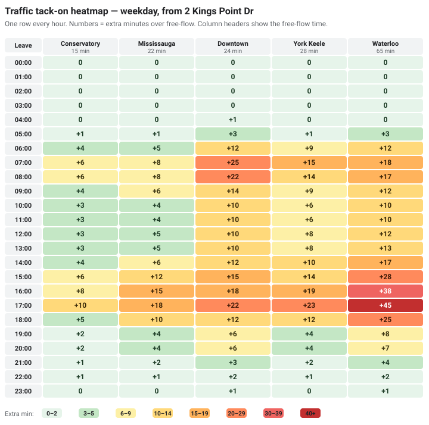

# Misc

Small standalone tools. Every tool in this repo is embedded below — preview first, then the link to open or download the tool itself.

## Tools

### Traffic tack-on heatmap

How many extra minutes to add for traffic, by hour of departure, leaving from 2 Kings Point Dr, Toronto, on a typical weekday. One row per hour (00:00–23:00); numbers are extra minutes over the free-flow time shown in each column header. Colour runs green (+0–2 min) through deep red (+40+ min).

**Open the tool:** [traffic-tack-on-heatmap.html](traffic-tack-on-heatmap.html) — a single self-contained HTML file, no dependencies. GitHub shows it as source; download it (or clone the repo) and open it in a browser to use it.

**Reading it:** add the cell to the free-flow time. Downtown at 07:00 is 24 + 25 = ~49 minutes. York Keele at 17:00 is 28 + 23 = ~51 minutes.

**Weekends:** use the 10:00 row in the morning and the 12:00–13:00 rows in the afternoon — there is no weekday rush peak, with extra only near Square One and downtown on event days.

**Basis:** planning estimates, not live data. Toronto congestion data (TomTom Traffic Index 2025: morning rush 29 min 8 sec per 10 km, evening 34 min 5 sec; GTA highway peaks about +52% morning / +65% evening over free-flow) and the Geotab Altitude Gardiner study (the Gardiner between Hwy 427 and Cherry St takes roughly double its pre-construction time in the AM rush). One crash, bad weather, or a closure can double a cell on the day — check Waze or Google before a hard start time.

---

*New tools added to this repo get an embedded preview and an entry in this README, in this same format.*
